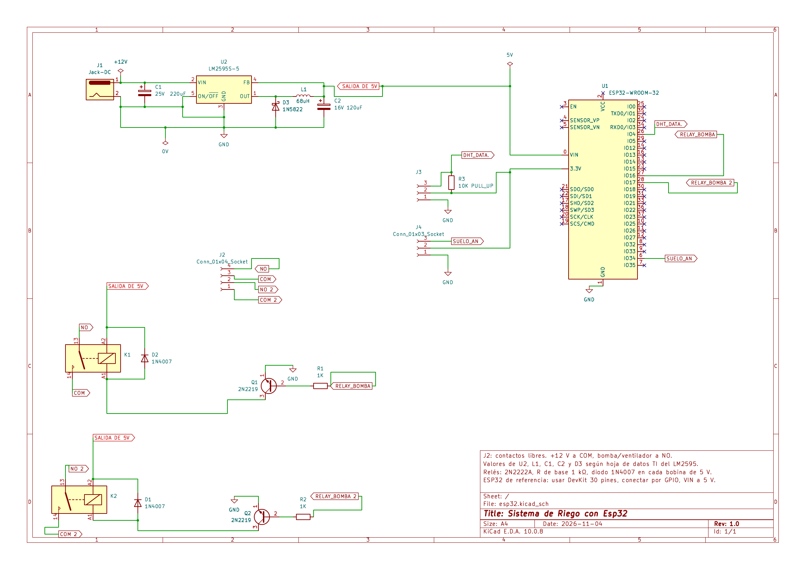

# Sistema de Riego con ESP32

🌐 [English](README.md) | **Español**

Control de una bomba y un ventilador de 12 V con un ESP32, a partir de las lecturas de temperatura, humedad ambiental y humedad del suelo.



📄 [Esquemático en PDF](sistema-riego-esp32.pdf)

| Concepto | Detalle |
|---|---|
| Revisión | 1.0 |
| Fecha del diagrama | 4 de noviembre de 2026 |
| Herramienta de diseño | KiCad 10 |
| Verificación | Revisión de reglas eléctricas (ERC) sin errores |
| Autor | Erick Soriano |

## Descripción general

Los 12 V de entrada se reducen a 5 V para el ESP32 y las bobinas de los relés. Los sensores se alimentan con los 3.3 V del DevKit, y los relés conmutan los 12 V de la bomba y del ventilador a través de J2.

```
Entrada 12 V (J1) → Fuente 5 V (LM2595-5) → ESP32 DevKit → Canal de relé 1 (GPIO16 · Q1 · K1) ┐
                    Sensor DHT22 (GPIO4)     → ESP32 DevKit → Canal de relé 2 (GPIO17 · Q2 · K2) ┼→ Salidas J2
                    Sensor de suelo (GPIO34) → ESP32 DevKit                                       ┘
```

## Descripción por etapas

El circuito se divide en cuatro etapas: alimentación, control, sensores y actuadores. Todas comparten la misma tierra (GND).

### Alimentación

- La entrada de 12 V llega por el jack DC (J1). El capacitor C1 de 220 µF / 25 V filtra la entrada.
- El regulador conmutado U2 (LM2595-5) baja de 12 V a 5 V fijos. Su terminal ON/OFF va a GND, así que el regulador queda siempre encendido, y FB se conecta a la salida de 5 V.
- La etapa de salida usa el inductor L1 de 68 µH, el diodo Schottky D3 (1N5822) y el capacitor C2 de 120 µF / 16 V. Los valores son los de la aplicación típica de la hoja de datos de Texas Instruments.
- La línea de 5 V (SALIDA DE 5V) alimenta la terminal VIN del ESP32 y las bobinas de los dos relés.
- Los 3.3 V de los sensores salen del pin 3.3V del DevKit, que tiene su propio regulador.

### Control

- El controlador es un ESP32 DevKit de 30 pines (módulo ESP32-WROOM-32), alimentado por VIN a 5 V.
- Las conexiones se indican por número de GPIO, no por número de pin del módulo.

### Sensores

- **DHT22** (temperatura y humedad ambiental), conector J3: la señal de datos va a GPIO4. La resistencia R3 de 10 kΩ funciona como pull-up entre la línea de datos y 3.3 V.
- **Sensor capacitivo de humedad del suelo**, conector J4: la salida analógica va a GPIO34. Ese pin pertenece al ADC1, que sigue funcionando con el WiFi activo. Al alimentarlo con 3.3 V, su salida nunca supera lo que admite el ADC.

### Actuadores

Hay dos canales de relé iguales. En cada uno, el GPIO excita la base de un transistor NPN 2N2222A a través de una resistencia de 1 kΩ. El emisor va a GND y el colector a la bobina del relé (A1). El otro extremo de la bobina (A2) va a 5 V. Un diodo 1N4007 en antiparalelo con la bobina, con el cátodo hacia 5 V, protege al transistor del pico de voltaje al apagar el relé.

| Canal | GPIO | Etiqueta | Resistencia de base | Transistor | Relé | Diodo | Contactos en J2 |
|---|---|---|---|---|---|---|---|
| 1 | GPIO16 | RELAY_BOMBA | R1, 1 kΩ | Q1, 2N2222A | K1, 5 V | D2, 1N4007 | NO y COM |
| 2 | GPIO17 | RELAY_BOMBA 2 | R2, 1 kΩ | Q2, 2N2222A | K2, 5 V | D1, 1N4007 | NO 2 y COM 2 |

Con 3.3 V en el GPIO, la corriente de base es de aproximadamente (3.3 V − 0.7 V) / 1 kΩ ≈ 2.6 mA, suficiente para saturar el transistor con una bobina de relé de 5 V común.

Los contactos de los relés son libres de potencial: se conecta +12 V al común (COM) y la bomba o el ventilador al contacto normalmente abierto (NO).

## Asignación de pines

| Pin del ESP32 | Etiqueta en el diagrama | Función | Conectado a |
|---|---|---|---|
| GPIO4 | DHT_DATA | Entrada/salida digital de datos | J3, pin 3 (DHT22) |
| GPIO16 | RELAY_BOMBA | Salida digital, canal 1 | R1 → base de Q1 |
| GPIO17 | RELAY_BOMBA 2 | Salida digital, canal 2 | R2 → base de Q2 |
| GPIO34 | SUELO_AN | Entrada analógica (ADC1) | J4, pin 3 (sensor de suelo) |
| VIN | SALIDA DE 5V | Alimentación de 5 V | Salida del LM2595 |
| 3.3V | — | Alimentación de sensores | J3 pin 2, J4 pin 2, R3 |
| GND | GND | Tierra común | Todo el circuito |

## Conectores

| Conector | Pin 1 | Pin 2 | Pin 3 | Pin 4 |
|---|---|---|---|---|
| J1, jack DC | +12 V | GND | — | — |
| J2, salidas de relé | COM 2 | NO 2 | COM | NO |
| J3, DHT22 | GND | 3.3 V | DATA (GPIO4) | — |
| J4, sensor de suelo | GND | 3.3 V | Señal (GPIO34) | — |

## Lista de materiales

| Referencia | Componente | Valor o modelo | Cantidad |
|---|---|---|---|
| U1 | Tarjeta de desarrollo | ESP32 DevKit, 30 pines | 1 |
| U2 | Regulador conmutado reductor | LM2595-5 (salida fija de 5 V) | 1 |
| L1 | Inductor | 68 µH | 1 |
| D3 | Diodo Schottky | 1N5822 | 1 |
| C1 | Capacitor electrolítico | 220 µF / 25 V | 1 |
| C2 | Capacitor electrolítico | 120 µF / 16 V | 1 |
| K1, K2 | Relé | Bobina de 5 V DC | 2 |
| Q1, Q2 | Transistor NPN | 2N2222A | 2 |
| R1, R2 | Resistencia | 1 kΩ | 2 |
| D1, D2 | Diodo rectificador | 1N4007 | 2 |
| R3 | Resistencia (pull-up) | 10 kΩ | 1 |
| J1 | Conector de entrada | Jack DC hembra | 1 |
| J2 | Conector de salidas de relé | 4 terminales | 1 |
| J3 | Conector del sensor DHT22 | 3 terminales | 1 |
| J4 | Conector del sensor de suelo | 3 terminales | 1 |
| — | Sensor de temperatura y humedad | DHT22 (AM2302) | 1 |
| — | Sensor de humedad del suelo | Capacitivo, salida analógica | 1 |

## Consideraciones de implementación

- **Regulador LM2595.** El integrado solo no funciona: necesita L1, D3, C1 y C2 con los valores indicados. Las versiones LM2595S-5.0 (TO-263) y LM2595T-5.0 (TO-220) comparten numeración: 1 salida, 2 entrada, 3 GND, 4 FB y 5 ON/OFF.
- **Transistores.** Antes de soldar, verifica el orden de terminales del modelo que compres. El PN2222A es E-B-C y el P2N2222A es C-B-E. En el diagrama cada terminal está marcada como E, B y C.
- **Diodos 1N4007.** Respeta la orientación: la banda (cátodo) va hacia los 5 V.
- **Relés.** Revisa que la huella del PCB coincida con el relé físico y que sus contactos soporten la corriente de arranque de la bomba y del ventilador.
- **ESP32.** Conecta por número de GPIO. El orden de pines cambia entre fabricantes de DevKit.
- **Sensor de suelo.** El ADC del ESP32 tiene ruido propio. Se recomienda promediar varias lecturas por software.

## Contenido de esta carpeta

- `sistema-riego-esp32.pdf` — esquemático completo (A4, una hoja)
- `schematic.png` — imagen del esquemático
- `README.md` — reporte técnico en inglés
- `README.es.md` — este reporte técnico en español

No incluye diseño de PCB ni programa para el ESP32.
