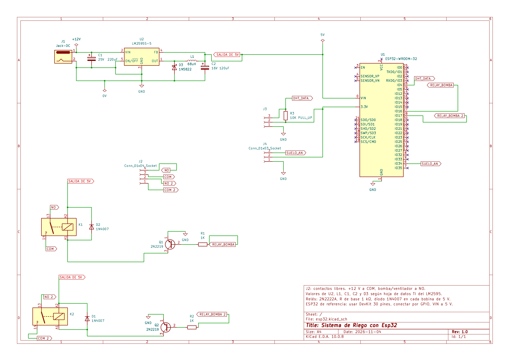

# ESP32 Irrigation System

🌐 **English** | [Español](README.es.md)

Controls a 12 V pump and a 12 V fan with an ESP32, based on temperature, air humidity and soil moisture readings.



📄 [Schematic (PDF)](sistema-riego-esp32.pdf)

| Item | Detail |
|---|---|
| Revision | 1.0 |
| Schematic date | November 4, 2026 |
| Design tool | KiCad 10 |
| Verification | Electrical Rules Check (ERC) with no errors |
| Author | Erick Soriano |

> Net labels in the schematic are in Spanish (e.g. `SALIDA DE 5V` = 5 V output, `SUELO_AN` = soil analog, `RELAY_BOMBA` = pump relay).

## Overview

The 12 V input is stepped down to 5 V for the ESP32 and the relay coils. The sensors are powered from the DevKit's 3.3 V pin, and the relays switch the 12 V pump and fan through J2.

```
12 V input (J1) → 5 V supply (LM2595-5) → ESP32 DevKit → Relay channel 1 (GPIO16 · Q1 · K1) ┐
                  DHT22 sensor (GPIO4)    → ESP32 DevKit → Relay channel 2 (GPIO17 · Q2 · K2) ┼→ J2 outputs
                  Soil sensor (GPIO34)    → ESP32 DevKit                                      ┘
```

## Circuit stages

The circuit has four stages: power, control, sensors and actuators. All of them share a common ground (GND).

### Power

- The 12 V input comes in through the DC jack (J1). Capacitor C1 (220 µF / 25 V) filters the input.
- The switching regulator U2 (LM2595-5) steps 12 V down to a fixed 5 V. Its ON/OFF pin is tied to GND, so the regulator is always on, and FB is connected to the 5 V output.
- The output stage uses inductor L1 (68 µH), Schottky diode D3 (1N5822) and capacitor C2 (120 µF / 16 V). These are the values from the typical application in the Texas Instruments datasheet.
- The 5 V rail (`SALIDA DE 5V`) feeds the ESP32's VIN pin and both relay coils.
- The sensors' 3.3 V comes from the DevKit's 3.3V pin, which has its own regulator.

### Control

- The controller is a 30-pin ESP32 DevKit (ESP32-WROOM-32 module), powered through VIN at 5 V.
- Connections are given by GPIO number, not by module pin number.

### Sensors

- **DHT22** (temperature and air humidity), connector J3: the data line goes to GPIO4. Resistor R3 (10 kΩ) is the pull-up between the data line and 3.3 V.
- **Capacitive soil moisture sensor**, connector J4: the analog output goes to GPIO34. That pin belongs to ADC1, which keeps working while WiFi is active. Since the sensor is powered from 3.3 V, its output never exceeds the ADC's input range.

### Actuators

There are two identical relay channels. In each one, the GPIO drives the base of a 2N2222A NPN transistor through a 1 kΩ resistor. The emitter goes to GND and the collector to the relay coil (A1). The other end of the coil (A2) goes to 5 V. A 1N4007 flyback diode across the coil, cathode towards 5 V, protects the transistor from the voltage spike when the relay turns off.

| Channel | GPIO | Label | Base resistor | Transistor | Relay | Diode | J2 contacts |
|---|---|---|---|---|---|---|---|
| 1 | GPIO16 | RELAY_BOMBA | R1, 1 kΩ | Q1, 2N2222A | K1, 5 V | D2, 1N4007 | NO and COM |
| 2 | GPIO17 | RELAY_BOMBA 2 | R2, 1 kΩ | Q2, 2N2222A | K2, 5 V | D1, 1N4007 | NO 2 and COM 2 |

With 3.3 V on the GPIO, the base current is about (3.3 V − 0.7 V) / 1 kΩ ≈ 2.6 mA, enough to saturate the transistor with a typical 5 V relay coil.

The relay contacts are dry (potential-free): connect +12 V to the common terminal (COM) and the pump or fan to the normally open contact (NO).

## Pin assignment

| ESP32 pin | Schematic label | Function | Connected to |
|---|---|---|---|
| GPIO4 | DHT_DATA | Digital data I/O | J3, pin 3 (DHT22) |
| GPIO16 | RELAY_BOMBA | Digital output, channel 1 | R1 → base of Q1 |
| GPIO17 | RELAY_BOMBA 2 | Digital output, channel 2 | R2 → base of Q2 |
| GPIO34 | SUELO_AN | Analog input (ADC1) | J4, pin 3 (soil sensor) |
| VIN | SALIDA DE 5V | 5 V supply | LM2595 output |
| 3.3V | — | Sensor supply | J3 pin 2, J4 pin 2, R3 |
| GND | GND | Common ground | Whole circuit |

## Connectors

| Connector | Pin 1 | Pin 2 | Pin 3 | Pin 4 |
|---|---|---|---|---|
| J1, DC jack | +12 V | GND | — | — |
| J2, relay outputs | COM 2 | NO 2 | COM | NO |
| J3, DHT22 | GND | 3.3 V | DATA (GPIO4) | — |
| J4, soil sensor | GND | 3.3 V | Signal (GPIO34) | — |

## Bill of materials

| Reference | Component | Value / model | Qty |
|---|---|---|---|
| U1 | Development board | ESP32 DevKit, 30 pins | 1 |
| U2 | Step-down switching regulator | LM2595-5 (fixed 5 V output) | 1 |
| L1 | Inductor | 68 µH | 1 |
| D3 | Schottky diode | 1N5822 | 1 |
| C1 | Electrolytic capacitor | 220 µF / 25 V | 1 |
| C2 | Electrolytic capacitor | 120 µF / 16 V | 1 |
| K1, K2 | Relay | 5 V DC coil | 2 |
| Q1, Q2 | NPN transistor | 2N2222A | 2 |
| R1, R2 | Resistor | 1 kΩ | 2 |
| D1, D2 | Rectifier diode | 1N4007 | 2 |
| R3 | Resistor (pull-up) | 10 kΩ | 1 |
| J1 | Input connector | Female DC jack | 1 |
| J2 | Relay output connector | 4 terminals | 1 |
| J3 | DHT22 connector | 3 terminals | 1 |
| J4 | Soil sensor connector | 3 terminals | 1 |
| — | Temperature and humidity sensor | DHT22 (AM2302) | 1 |
| — | Soil moisture sensor | Capacitive, analog output | 1 |

## Build notes

- **LM2595 regulator.** The chip doesn't work on its own: it needs L1, D3, C1 and C2 with the values shown. The LM2595S-5.0 (TO-263) and LM2595T-5.0 (TO-220) share the same pinout: 1 output, 2 input, 3 GND, 4 FB, 5 ON/OFF.
- **Transistors.** Before soldering, check the pin order of the part you buy. The PN2222A is E-B-C and the P2N2222A is C-B-E. Each pin is marked E, B and C in the schematic.
- **1N4007 diodes.** Mind the orientation: the band (cathode) goes towards 5 V.
- **Relays.** Make sure the PCB footprint matches the physical relay and that its contacts can handle the inrush current of the pump and fan.
- **ESP32.** Wire by GPIO number. Pin order changes between DevKit manufacturers.
- **Soil sensor.** The ESP32's ADC is noisy. Averaging several readings in software is recommended.

## Folder contents

- `sistema-riego-esp32.pdf` — full schematic (A4, one sheet)
- `schematic.png` — schematic image
- `README.md` — this technical report in English
- `README.es.md` — technical report in Spanish

PCB layout and ESP32 firmware are not included.
